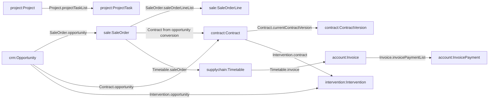

# Commercial, finance and operations domain fields — pinned source-level relationships

**Source:** `axelor/axelor-open-suite@e7cbea53bae88d2540f59a70b09bf0f326f1022e` (tag v9.1.10). These declared fields were checked in the exact upstream XMLs and represent **potential reusable data**, not a current IOETI API or a completed certified workflow.

**IMPORTANT:** the existing custom UI and authorized /ws/ioeti/* only expose Business Line, Lead, Account, minimal Opportunity. The classes below have **no implemented, reviewed user-facing IOETI quote/contract/invoice/operations APIs** on the audited base. Never expose them through generic /ws/rest in the browser.

## Exact source field-to-domain relations

| Source domain XML | Confirmed field(s) | IOETI role and limitation |
|---|---|---|
| `axelor-sale/domains/SaleOrder.xml` | `opportunity`, `clientPartner`, `contactPartner`, `saleOrderLineList`, `priceList`, `currency`, `statusSelect`, `versionNumber` | Reuse commercial quote/order links; does **not** natively supply IOETI A/B/C alternatives or discount approval evidence |
| `SaleOrder.xml` | `exTaxTotal`, `taxTotal`, `inTaxTotal`, `advanceTotal`, `amountToBeSpreadOverTheTimetable`, `discountTypeSelect`, `discountAmount` | Financial amounts require approved role/field policy and precise currency/tax semantics |
| `SaleOrder.xml` | `companyCostTotal`, `totalCostPrice`, `totalGrossMargin`, `marginRate`, `markup`, `internalNote` | **Sensitive**: finance-only or owner-approved cost fields must never leak to generic sales DTO |
| `axelor-sale/domains/SaleOrderLine.xml` | `saleOrder`, `product`, `qty`, `unit`, `price`, `taxLineSet`, `discountAmount`, `exTaxTotal`, `inTaxTotal` | Reuse pricing line core for service quoting; quotation builder must retain version and approval gates |
| `SaleOrderLine.xml` | `subTotalCostPrice`, `subTotalGrossMargin`, `companyCostTotal` | Line-level sensitive costs require distinct permission and negative export tests |
| `axelor-contract/domains/Contract.xml` | `opportunity`, `partner`, `invoicedPartner`, `currentContractVersion`, `versionHistory`, `startDate`, `endDate`, `renewalNumber`, `statusSelect` | Strong native backbone for contract versions, but legal review / signature / ISO independence remains IOETI-specific |
| `Contract.xml` | `contractId`, `contractTypeSelect`, `contractLineList`? | Do **not** presume `contractLineList` exists directly: not present among checked base domain fields. Use `ContractVersion.contractLineList` and inspect other module extensions and services before implementation |
| `axelor-contract/domains/ContractVersion.xml` | `contract`, `contractLineList`, `contractFileList`, `activationDateTime`, `endDateTime`, `isTacitRenewal`, `renewalDuration`, `paymentMode`, `paymentCondition` | Document/finance lineage must be version-consistent, attachments protected and review evidence immutable |
| `ContractVersion.xml` | `initialExTaxTotalPerYear`, `yearlyExTaxTotalRevalued`, `totalInvoicedAmount`, `totalPaidAmount` | Derived finance figures need accountants to define posting vs reporting and per-tenant access |
| `axelor-account/domains/Invoice.xml` | `partner`, `contactPartner`, `company`, `invoiceLineList`, `invoicePaymentList`, `paymentSchedule`, `dueDate`, `amountPaid`, `amountRemaining` | Native invoice ledger primitives; do not equate IOETI invoice request with legally issued/postable invoice |
| `Invoice.xml` | `bankDetails`, `partnerTaxNbr`, `journal`, `move`, `companyTaxNumber`, `vatSystemSelect`, `fiscalPosition`, `amountRejected` | **Sensitive/regulatory**: no sales-role exposure, no raw entity serialization or unrestricted export |
| `axelor-supplychain/domains/Timetable.xml` | `amount`, `percentage`, `invoiced`, `estimatedDate`, `saleOrder`, `purchaseOrder`, `invoice` | Direct link from sale order to invoice milestone, but IOETI trigger/cause/completion idempotency must be added |
| `axelor-project/domains/Project.xml` | `clientPartner`, `contactPartner`, `projectTaskList`, `resourceBookingList`, `projectStatus`, `assignedTo`, `team`, `parentProject` | Strong scheduling/engagement backbone; no native signed-sales-to-operations IOETI Handover verified |
| `axelor-project/domains/ProjectTask.xml` | `project`, `assignedTo`, `status`, `taskDeadline`, `priority`, `progress`, `parentTask`, `durationHours`, `watcherUserSet` | Task-level authorization, due date escalation, time tracking and checklists should be permission-scoped |
| `axelor-intervention/domains/Intervention.xml` | `opportunity`, `linkedSaleOrder`, `contract`, `customerRequest`, `deliveredPartner`, `contact`, `interventionRangeList`, `assignedTo`, `startDateTime`, `endDateTime` | Source relationship supports field visits; **not** certificate decisions or accreditation policy |
| `axelor-quality/domains/QualityImprovement.xml` | `gravityTypeSelect`, `qiStatus`, `qiIdentification`, `qiResolution`, `qiAnalysis`, `technicalSeq` | Existing quality-improvement backbone; client ISO cycle, NC decisions/independent review need separate approved model |

## Source-backed graph — commercial + delivery

**Edges tagged with XML property names are source-confirmed.** The `Contract from opportunity conversion` arrow is a **service capability** supported by `ContractService.generateContractFromOpportunity`, not a direct `SaleOrder.contract` field. Project/contract handover link is not asserted as a source-confirmed direct field; it requires a new IOETI Engagement/Handover model.

## Transactional and permission boundaries

- For Quote: verify source opportunity (own/team/line) and Partner/Contact permissions before creating quotation; never expose sale cost/margin to unauthorized users.
- For Contract: verify access to both parent opportunity and ContractVersion/files, with independent legal signing and status approvals.
- For Timetable: parent `saleOrder` and resulting `invoice` must be idempotent by event; a double-click or outbox replay must not duplicate invoice.
- For Invoices: separate issued, paid, reconciled, credited; never count payment progress as proof of bank settlement.
- For Project: plan work only after documented Handover acceptance; reading task does not imply permission to read confidential commercial terms.
- For Intervention: client-specific visit checklist/attachments authorization does not inherit from the existence of an Opportunity field.
- For QualityImprovement: internal QMS activities cannot act as independent external certificate issuance permission.

## Associated traceability and release dependencies

- `CAT-001..016`, `QT-001..019`, `CT-001..011`, `FIN-001..016`, `OPS-001..012`, `ISO-001..028` in the 377-row trace ledgers.
- `G-003` field read exposure; `G-004` own/team/line record scope; `G-024` Handover; `G-026` bilingual PDF; `G-040..053` complete business domains.
- 52 UI surface contracts in `UI_API_SURFACE_CONTRACTS.json` are **proposed** except explicitly marked states; no user-authenticated integration approval yet.
- Pin a dedicated DTO for each business service and write negative tests verifying sensitive properties are **absent**, not only that visible ones render.

## Critical verification limits

This audit verifies **field declarations in 10 exact upstream files** using the pinned tag. It does not yet inspect every native Java service's implementation, inherited fields, 26-module XML extension collision, database migrations, applicable AGPL/commercial module packaging, or any actual role-based UI runtime flows. Before implementation verify the exact installed artifacts and runtime environment.
